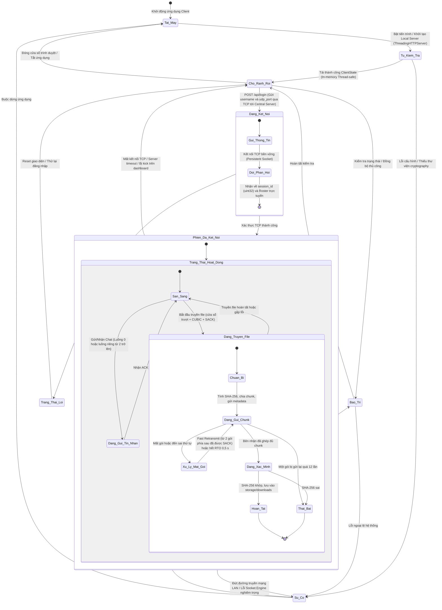

# PROTOCOL SPECIFICATION & SYSTEM ARCHITECTURE
**Project:** Distributed and Streaming-based Client-Server Collaboration Application  
**Document Status:** Bản đặc tả giao thức của dự án  

---

## 1. SYSTEM ARCHITECTURE OVERVIEW

Hệ thống áp dụng kiến trúc lai (**Hybrid**) phân tách rõ ràng giữa mặt phẳng điều khiển (**Control Plane**, TCP) và mặt phẳng dữ liệu (**Data Plane**, UDP). Ở chế độ có Central Server, mọi dữ liệu chat, file và ACK đều đi qua UDP Relay của server. Chế độ P2P thuần (không đặt `--server-host`) chỉ là chế độ dự phòng, dùng UDP broadcast discovery và truyền trực tiếp giữa các peer. Giao diện người dùng và dashboard quản trị được tách khỏi lõi xử lý mạng.

```
+-----------------------------------------------------------------------------------+
|                                CLIENT NODE ARCHITECTURE                           |
|                                                                                   |
|  +-----------------------+      In-Memory State      +-------------------------+  |
|  |   Web UI (Browser)    | <-----------------------> |    ClientState (RAM)    |  |
|  | (HTML / Vanilla JS)   |    Local HTTP Loopback    |   (Thread-Safe RLock)   |  |
|  +-----------------------+    (127.0.0.1:8080)       +-------------------------+  |
|                                                                    ^              |
|                                                                    |              |
|  +-----------------------------------------------------------------v-----------+  |
|  |                         SOCKET ENGINE (network/socket_engine.py)            |  |
|  |  +-------------------+   +-------------------+   +-----------------------+  |  |
|  |  |  CryptoEngine     |   | ReliabilityLayer  |   |   StreamManager       |  |  |
|  |  | (AES-128-CBC)     |   | (CUBIC + SACK)    |   | (Chunking & SHA-256)  |  |  |
|  |  +-------------------+   +-------------------+   +-----------------------+  |  |
|  +----------------------------------+-------------------------------+----------+  |
|                                     |                               |             |
+-------------------------------------|-------------------------------|-------------+
                                      |                               |
                   TCP Control Plane  |                               | UDP Data Plane
                   (Port 9001)        |                               | (Port 9002)
                                      v                               v
+-----------------------------------------------------------------------------------+
|                         CENTRAL LAN SERVER (network/central_server.py)            |
|                                                                                   |
|  +-----------------------+      Shared State         +-------------------------+  |
|  | TCP Presence & Auth   | <-----------------------> |  UDP Datagram Relay     |  |
|  | - Session Allocation  |                           |  - Unicast/Broadcast    |  |
|  | - Roster Broadcast    |                           |  - Chat/File/ACK Relay  |  |
|  | - Ping / Timeout      |                           |  - Metrics & Telemetry  |  |
|  +-----------------------+                           +-------------------------+  |
|                                     ^                                             |
|                                     | Loopback HTTP (127.0.0.1:9003)              |
|                                     v                                             |
|                        +-------------------------+                                |
|                        | CentralDashboardServer  |                                |
|                        +-------------------------+                                |
+-----------------------------------------------------------------------------------+
```

### 1.1 State Diagram



### 1.2 Module Coupling & Responsibilities
* **`core/protocol.py`:** Định nghĩa định dạng nhị phân của gói tin (`Packet`), tính toán checksum (16 bit thấp của CRC-32), và mã hóa/giải mã các khối `SACK`.
* **`core/crypto.py`:** Cung cấp lớp bảo mật `CryptoEngine` sử dụng mã hóa đối xứng **AES-128-CBC** với vector khởi tạo ngẫu nhiên (`IV`) và đệm `PKCS7`.
* **`core/state.py`:** Lưu trữ trạng thái đồng bộ đa luồng (`ClientState`) đóng vai trò là cầu nối dữ liệu giữa `SocketEngine` và `LocalAPIServer`.
* **`network/central_client.py` & `network/central_server.py`:** Duy trì phiên kết nối TCP bền vững để xác thực người dùng, cấp phát `session_id`, đồng bộ danh sách peer trực tuyến (`roster`), và chuyển tiếp gói tin UDP (`RLY1`).
* **`network/reliability.py`:** Hiện thực hóa cơ chế truyền tin cậy trên UDP thông qua cửa sổ trượt (`SlidingWindowSender`), kiểm soát tắc nghẽn **TCP CUBIC**, xác nhận chọn lọc (**SACK**), và sắp xếp thứ tự nhận (`StreamReceiver`).
* **`network/streaming.py`:** Phân mảnh tập tin thành các chunk tối đa `1350 bytes` (`FileTransferManager`), kiểm tra toàn vẹn dữ liệu qua **SHA-256**, và tái lắp ráp tập tin (`StreamManager`).
* **`network/socket_engine.py`:** Bộ điều phối trung tâm (Orchestrator) kết nối tất cả các module trên để gửi/nhận gói tin bất đồng bộ.

---

## 2. CONTROL PLANE PROTOCOL (TCP — PORT 9001)

Mặt phẳng điều khiển sử dụng kết nối **TCP Persistent** với định dạng thông điệp **NDJSON (Newline-Delimited JSON)** kết thúc bằng ký tự `\n` (giới hạn tối đa `4096 bytes`/dòng).

### 2.1 Handshake & Authentication Flow
1. **Client $\rightarrow$ Server (`login`):**
   ```json
   {"type": "login", "username": "alice", "udp_port": 9000}
   ```
2. **Server $\rightarrow$ Client (`login_ack`):**
   * *Thành công:* Server cấp phát ngẫu nhiên một `session_id` 32-bit không trùng lặp ($1 \le \text{session\_id} \le \text{0xFFFFFFFF}$) và trả về danh sách các peer đang hoạt động.
     ```json
     {
       "type": "login_ack",
       "success": true,
       "session_id": 284910234,
       "peers": [
         {"username": "bob", "session_id": 918273645, "ip": "192.168.1.15", "port": 9000}
       ]
     }
     ```
   * *Thất bại:* Trả về `"success": false` kèm trường `"error"` (tên rỗng, trùng tên đang online không phân biệt hoa/thường, sai cổng UDP ngoài khoảng 1–65535).

### 2.2 Presence, Heartbeat & Diagnostics
* **Roster Synchronization (`roster`):** Bất cứ khi nào có client đăng nhập mới, ngắt kết nối, hoặc bị quản trị viên kick, Server phát quảng bá danh sách cập nhật tới toàn bộ kết nối TCP hiện hành:
  ```json
  {"type": "roster", "users": [...]}
  ```
* **Keep-Alive Heartbeat (`ping`):** Client gửi định kỳ mỗi `3.0 giây`. Nếu Server không nhận được tín hiệu trong vòng `15.0 giây` (`client_timeout`), kết nối bị ngắt và xóa khỏi `roster`.
  ```json
  {"type": "ping"}
  ```
* **Security & Integrity Telemetry (`warning`):** Client báo cáo các bất thường về gói tin tới Server Dashboard (`invalid_packet`, `decrypt_failure`, `file_decode_failure`):
  ```json
  {"type": "warning", "category": "decrypt_failure"}
  ```

---

## 3. DATA PLANE BINARY PACKET FORMAT (UDP — PORT 9002)

Tất cả các gói tin trên mặt phẳng dữ liệu đều tuân thủ cấu trúc Header cố định **24 bytes** theo chuẩn thứ tự byte mạng (**Big-Endian / Network Byte Order**, format `!HBBIIIIHH`: 2+1+1+4+4+4+4+2+2 = 24).

### 3.1 Binary Header Layout

```
+---------------+---------+---------+------------+-----------+----------+----------+-------------+------------+------------------+
|  Magic Number | Version |  Flags  | Session ID | Stream ID | Seq Num  | ACK Num  | Payload Len |  Checksum  |     Payload      |
|   (0x4E41)    |   (1)   |(bitmask)|  (uint32)  | (uint32)  | (uint32) | (uint32) |  (uint16)   |(CRC32/16b) |  (AES / SACK)    |
+---------------+---------+---------+------------+-----------+----------+----------+-------------+------------+------------------+
|<-- 2 Bytes -->|<--1B--->|<--1B--->|<-- 4B ---->|<-- 4B --->|<-- 4B -->|<-- 4B -->|<--- 2B --->|<--- 2B --->|<-- Variable B -->|
|<---------------------------------------------- HEADER (24 Bytes) ------------------------------------------->|<----- DATA ----->|
```

### 3.2 Header Field Specifications

| Field | Size | Type | Description |
| :--- | :--- | :--- | :--- |
| **Magic** | 2 Bytes | `uint16` | Hằng số nhận diện giao thức: `0x4E41` (`"NA"`). Gói tin sai Magic bị loại bỏ ngay lập tức. |
| **Version** | 1 Byte | `uint8` | Phiên bản giao thức hiện hành: `1`. |
| **Flags** | 1 Byte | `uint8` | Mặt nạ bit (Bitmask) xác định loại gói tin điều khiển hoặc dữ liệu. |
| **Session ID** | 4 Bytes | `uint32` | Mã định danh phiên của người gửi do Central Server cấp phát. |
| **Stream ID** | 4 Bytes | `uint32` | Mã định danh luồng độc lập nhằm loại bỏ **Head-of-Line (HoL) Blocking**. |
| **Seq Num** | 4 Bytes | `uint32` | Số thứ tự đơn điệu tăng dần trên từng `Stream ID` (bắt đầu từ `1`; gói ACK mang giá trị `0`). |
| **ACK Num** | 4 Bytes | `uint32` | Số thứ tự tích lũy (Cumulative ACK): số `Seq` kế tiếp mà bên nhận đang chờ. |
| **Payload Len** | 2 Bytes | `uint16` | Độ dài thực tế tính bằng byte của phần `Payload` theo sau Header. |
| **Checksum** | 2 Bytes | `uint16` | **16 bit thấp của CRC-32**: `zlib.crc32(Header_Zero_CRC + Payload) & 0xFFFF`. Dùng để phát hiện lỗi truyền, không phải xác thực. |

### 3.3 Control Bitmask Flags

| Flag Name | Hex Value | Binary | Description |
| :--- | :--- | :--- | :--- |
| `FLAG_AUTH` | `0x01` | `00000001` | Dự phòng; đăng nhập hiện đi qua TCP nên chưa sử dụng. |
| `FLAG_DISCOV` | `0x02` | `00000010` | Gói tin quảng bá khám phá peer nội mạng (`255.255.255.255`); chỉ dùng ở chế độ P2P. |
| `FLAG_MSG` | `0x04` | `00000100` | Gói tin mang thông điệp văn bản (Chat message). |
| `FLAG_FILE` | `0x08` | `00001000` | Gói tin mang metadata khởi tạo tệp hoặc chunk dữ liệu nhị phân của tệp. |
| `FLAG_ACK` | `0x10` | `00010000` | Gói tin xác nhận đã nhận dữ liệu (kèm theo SACK blocks trong payload). |
| `FLAG_HEARTBEAT`| `0x20` | `00100000` | Gói tin duy trì kết nối giữa các peer; chỉ dùng ở chế độ P2P. |
| `FLAG_SYN` | `0x40` | `01000000` | Dự phòng cho khởi tạo luồng; chưa sử dụng. |
| `FLAG_FIN` | `0x80` | `10000000` | Dự phòng cho kết thúc luồng; chưa sử dụng. |

### 3.4 Server UDP Relay Envelope (`RLY1`)
Khi hoạt động ở chế độ Client-Server trung tâm, gói tin nhị phân `Packet` được bọc trong một phong bì định tuyến có tiền tố `RLY1` (4 bytes) kèm JSON metadata:
* **Client $\rightarrow$ Server (`relay`):**
  ```text
  RLY1{"type":"relay","sender_session_id":284910234,"target_session_id":918273645,"packet":"<Base64_Packet>"}
  ```
  *(Nếu truyền file, phong bì đính kèm thêm trường `"file"` chứa `transfer_id`, `filename`, `filesize`, `total_chunks`, `first_seq` và `"retry_count"` để Server giám sát tiến độ).*
* **Server $\rightarrow$ Target Client (`deliver`):**
  ```text
  RLY1{"type":"deliver","sender_session_id":284910234,"packet":"<Base64_Packet>"}
  ```

`target_session_id = 0` biểu thị broadcast tới các client còn lại; trên thực tế client gửi riêng một bản (với cửa sổ trượt riêng) cho từng peer.

**Kiểm tra của Server trước khi chuyển tiếp:** IP và cổng UDP nguồn khớp phiên đăng nhập; `Session ID` trong gói khớp người gửi; tên file không chứa đường dẫn; kích thước file không quá 200 MB; số chunk phù hợp kích thước; sequence number nằm trong khoảng đã khai báo; số lần gửi lại không vượt quá 12.

**Kích thước datagram:** gói `Packet` tối đa khoảng 1400 byte. Base64 làm tăng kích thước thêm 4/3 (khoảng 1870 byte), cộng JSON thành khoảng 2 KB, vượt MTU 1500 nên datagram relay có thể bị phân mảnh IP (xem mục 6 và mục 8).

---

## 4. STREAM MULTIPLEXING & HoL BLOCKING ELIMINATION

Để ngăn chặn các luồng truyền tập tin dung lượng lớn làm nghẽn các tin nhắn thời gian thực, giao thức phân tách dữ liệu thành các **Stream ID** độc lập:

* **`Stream ID = 0` (Global Broadcast Chat):** Kênh trò chuyện chung toàn mạng.
* **`Stream ID = private_stream_id(A, B)` (Private Unicast Chat):** Kênh trò chuyện riêng tư giữa 2 peer, tính toán tất định bằng hàm băm:
  $$\text{StreamID} = \text{CRC32}(\text{"}\min(\text{ID}_A, \text{ID}_B)\text{:}\max(\text{ID}_A, \text{ID}_B)\text{"}) \bmod 2^{32}$$
  *(Nếu kết quả $\le 1$, cộng thêm $2$ để tránh xung đột với kênh hệ thống).*
* **`Stream ID = Random(2, 0xFFFFFFFE)` (Ephemeral File Transfer Stream):** Mỗi lần truyền một tập tin mới sẽ khởi tạo một `Stream ID` ngẫu nhiên riêng biệt.

Hàng đợi truyền lại (`SlidingWindowSender`) và bộ đệm sắp xếp (`StreamReceiver`) hoạt động độc lập theo khóa `(stream_id, peer)`, trong đó `peer` là `Session ID` của đối phương ở chế độ relay (hoặc IP/cổng UDP ở chế độ P2P). Nhờ vậy gói file bị mất chỉ làm chậm stream file đó, còn tin nhắn chat vẫn được xử lý ngay.

---

## 5. RELIABILITY, SACK & CONGESTION CONTROL

### 5.1 Selective Acknowledgment (SACK) Payload Format
Khi gửi gói tin có cờ `FLAG_ACK`, phần `Payload` chứa danh sách các khối dữ liệu đã nhận được không liên tục (Out-of-order) theo chuẩn **RFC 2018**:

```
+--------------+-------------+-------------------+-------------------+-----+-------------------+
| SACK Version | Block Count |   SACK Block #1   |   SACK Block #2   | ... |   SACK Block #N   |
|     (1)      |   (0..32)   |  [Left  | Right)  |  [Left  | Right)  |     |  [Left  | Right)  |
+--------------+-------------+-------------------+-------------------+-----+-------------------+
|<--- 1B ----->|<--- 1B ---->|<---- 4B + 4B ---->|<---- 4B + 4B ---->|     |<---- 4B + 4B ---->|
```

* Mỗi khối biểu diễn nửa khoảng `[left, right)` dưới dạng số nguyên không dấu 32-bit (`!II`), tuân thủ điều kiện: $1 \le \text{left}_1 < \text{right}_1 \le \text{left}_2 < \text{right}_2 \le \text{0xFFFFFFFF}$.
* **Fast Retransmit:** Nếu bên gửi nhận thấy có ít nhất `SACK_LOSS_THRESHOLD = 2` **gói** nằm phía trên một gói chưa được xác nhận đã được SACK (đếm theo gói, không đếm theo block), gói đó được đánh dấu mất và truyền lại ngay mà không cần chờ hết `RTO = 0.5s`.
  *Ví dụ:* gửi gói 1–5, bên nhận chỉ có 2, 4, 5. ACK mang `ack = 1` và hai block `[2,3)`, `[4,6)`. Gói 1 có 3 gói phía trên đã được SACK, gói 3 có 2 gói (4 và 5), nên cả hai được gửi lại ngay dù gói 3 chỉ có một block phía trên.

### 5.2 TCP CUBIC Congestion Control (RFC 8312)
Mỗi `SlidingWindowSender` duy trì một cửa sổ tắc nghẽn động (`cwnd`) khởi tạo bằng `4.0` gói tin (tối thiểu `2.0`, giới hạn tối đa `window_size = 8` gói, `ssthresh` ban đầu bằng `8`):
* **Giai đoạn Slow Start ($\text{cwnd} < \text{ssthresh}$):** Mỗi gói được xác nhận làm $\text{cwnd}$ tăng thêm 1, nên sau mỗi vòng RTT $\text{cwnd}$ gần như nhân đôi.
* **Giai đoạn Congestion Avoidance (CUBIC Function):**
  $$W(t) = C \cdot (t - K)^3 + W_{\max}$$
  Trong đó: $C = 0.4$, $\beta = 0.7$, $t$ là thời gian trôi qua kể từ lần mất gói gần nhất, và điểm uốn $K$ được tính bằng:
  $$K = \sqrt[3]{\frac{W_{\max} \cdot (1 - \beta)}{C}}$$
* **TCP-Friendly Region:** Tại mỗi bước cập nhật, thuật toán đối chiếu với mô hình TCP Reno ($W_{\text{tcp}}(t)$) và chọn $\max(W(t), W_{\text{tcp}}(t))$ để đảm bảo thông lượng công bằng. RTT trong công thức Reno được ước lượng bằng $\max(0.01, RTO/2)$, không đo RTT thực tế.
* **Phản ứng khi mất gói (Loss Event):** Cập nhật $W_{\max} = \text{cwnd}$, giảm $\text{ssthresh} = \max(2.0, \text{cwnd} \cdot \beta)$, đặt lại $\text{cwnd} = \text{ssthresh}$, và khởi tạo chu kỳ CUBIC mới. $\text{cwnd}$ chỉ giảm một lần cho mỗi đợt mất gói.
* **Giới hạn thử lại:** Nếu một gói bị gửi lại quá `MAX_RETRIES = 12` lần, stream được đánh dấu thất bại và bên gửi báo lỗi thay vì chờ vô hạn.

---

## 6. RELIABLE FILE TRANSFER LIFECYCLE

Quá trình truyền tập tin kích thước lớn qua UDP gồm 3 bước, nhằm hạn chế phân mảnh IP và đảm bảo toàn vẹn dữ liệu:

1. **Chunking & Integrity Hashing (`FileTransferManager`):**
   * Tập tin gốc được đọc tuần tự và cắt thành các mảnh kích thước tối đa **`1350 bytes`**. Sau AES-CBC/PKCS7 mỗi chunk tối đa 1376 byte (IV 16 + bản mã 1360); cộng Header 24 byte thành khoảng 1400 byte; cộng UDP và IPv4 là 1428 byte, dưới MTU 1500 khi gửi trực tiếp (chế độ P2P).
   * Khi đi qua relay, phong bì Base64 và JSON làm datagram tăng lên khoảng 2 KB, nên có thể bị phân mảnh IP. Cơ chế SACK và gửi lại bù cho trường hợp mất mảnh; hướng cải thiện là thay phong bì Base64 bằng định dạng nhị phân.
   * Toàn bộ nội dung tệp được băm bằng thuật toán **SHA-256**.
2. **Metadata Initialization (`seq_num = 1`):**
   * Gói tin đầu tiên trên luồng truyền file mang cờ `FLAG_FILE` chứa chuỗi JSON metadata được mã hóa AES:
     ```json
     {
       "filename": "report.pdf",
       "filesize": 1288192,
       "total_chunks": 955,
       "sha256": "e3b0c44298fc1c149afbf4c8996fb92427ae41e4649b934ca495991b7852b855",
       "transfer_id": "a1b2c3d4e5f6...",
       "chat_stream_id": 0
     }
     ```
3. **Chunk Transmission & Reassembly (`seq_num = 2 ... N+1`):**
   * Các chunk dữ liệu được mã hóa độc lập và đẩy vào cửa sổ trượt CUBIC.
   * Tại bên nhận (`StreamManager`), sau khi thu thập đủ `total_chunks` theo đúng thứ tự từ `StreamReceiver`, hệ thống ghép nối các byte và đối chiếu mã băm **SHA-256**. Nếu khớp, tệp được lưu vào thư mục `storage/downloads/` (tự động đánh số hậu tố `_1`, `_2` nếu trùng tên). Nếu SHA-256 sai, bên nhận đánh dấu truyền thất bại.

---

## 7. CRYPTOGRAPHIC SECURITY LAYER

Payload của gói tin `FLAG_MSG` và `FLAG_FILE` được mã hóa bằng khóa chung của các client trước khi đóng gói vào `Packet`; Central Server chỉ chuyển tiếp và không cần khóa để giải mã payload:

* **Thuật toán:** **AES-128** (Advanced Encryption Standard với độ dài khóa 128-bit).
* **Chế độ vận hành:** **CBC** (Cipher Block Chaining) kết hợp đệm chuẩn **PKCS7** (block size 128-bit).
* **Khóa:** 16 byte lấy từ biến môi trường `CNET_SECRET_KEY`; nếu không đặt, dùng khóa tĩnh trong mã nguồn. Mọi client phải dùng cùng một khóa.
* **Cấu trúc Ciphertext trên đường truyền:**
  ```
  +------------------------+---------------------------------------+
  |  Random IV (16 Bytes)  |   AES-128-CBC Ciphertext (N * 16 B)   |
  +------------------------+---------------------------------------+
  ```
* Mỗi gói tin sử dụng một vector khởi tạo ngẫu nhiên `IV = os.urandom(16)` độc lập, nên gửi lặp lại cùng một nội dung vẫn cho bản mã khác nhau.
* **Không được mã hóa:** Header, gói ACK/SACK và các thông điệp điều khiển TCP. Vì vậy kích thước và thời điểm gói vẫn quan sát được.

---

## 8. HẠN CHẾ ĐÃ BIẾT

* Khóa AES dùng chung, không có trao đổi khóa; CBC không kèm MAC nên không chống sửa đổi có chủ đích.
* RTO cố định 0,5 giây; RTT trong công thức CUBIC/Reno được ước lượng từ RTO, không đo thực tế.
* Phong bì relay dùng Base64 nên datagram tăng lên khoảng 2 KB và có thể bị phân mảnh IP.
* Stream ID chat riêng (CRC-32) và stream ID file (ngẫu nhiên) có thể va chạm với xác suất rất nhỏ.
* Bên gửi chưa được báo khi bên nhận ghép file thất bại.
* `to_json_snapshot()` chỉ là bản sao nông của trạng thái.
